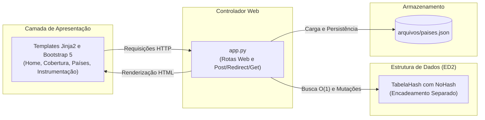

# 🚀 GlobalSIM — Roadmap & Backlog de Implementação (Etapa 1)

<p align="left">
  
  
  
  
  
</p>

> **Instituição:** Universidade do Estado da Bahia (UNEB) — Campus I  
> **Colegiado:** Bacharelado em Sistemas de Informação  
> **Disciplina:** Estruturas de Dados II  
> **Docente:** Profa. Maria Inés Restovic  
> **Equipe:** Arthur Felipe, Lucas Vinicius, Raphael Lopes

---

## 📊 Dashboard de Progresso

| Módulo / Camada | Componente Principal | Status | Conclusão |
| :--- | :--- | :---: | :---: |
| **Estrutura de Dados** | [`estruturas/tabela_hash.py`](estruturas/tabela_hash.py) | ✅ Concluído | **100%** |
| **Controlador & Persistência** | [`app.py`](app.py) + [`arquivos/paises.json`](arquivos/paises.json) | ✅ Concluído | **100%** |
| **Interface do Usuário** | [`templates/`](templates/) (Bootstrap 5 + Jinja2) | ✅ Concluído | **100%** |
| **Estilização & Identidade Visual** | [`static/`](static/) | ✅ Concluído | **100%** |

---

## 🏗️ Arquitetura da Etapa 1



> [!IMPORTANT]
> **Regra Obrigatória da Disciplina:** É estritamente proibido o uso de `dict` ou bibliotecas prontas como mecanismo principal de indexação e busca. A Tabela Hash deve ser construída manualmente com tratamento de colisões (encadeamento separado via `NoHash`), cálculo de dispersão polinomial e instrumentação didática.

---

## 📋 Checklist Detalhado por Módulo

### 1. `estruturas/tabela_hash.py` (Núcleo da Estrutura de Dados)
- [x] **`NoHash` (Nó da Lista Encadeada)**
  - [x] Campos `chave` (código do país), `valor` (dicionário de dados) e ponteiro `proximo`.
- [x] **`_hash(self, chave: str) -> int`**
  - [x] Implementação da função polinomial de base 31 para strings curtas.
  - [x] Operador módulo (`% self.capacidade`) garantindo intervalo $[0, M - 1]$.
  - [x] Padronização automática em maiúsculas (`.strip().upper()`).
- [x] **`inserir(self, chave: str, valor: dict)`**
  - [x] Tratamento de bucket vazio ($O(1)$).
  - [x] Encadeamento separado com `NoHash` em caso de colisão.
  - [x] Atualização de chave já existente (*update*) sem duplicatas e sem contar colisão.
  - [x] Incremento de `self.tamanho` e acumulação de `self.total_colisoes`.
- [x] **`buscar(self, chave: str) -> dict | None`**
  - [x] Busca na cadeia de sinônimos em tempo $O(1)$ médio.
  - [x] Retorno do dicionário com dados do país ou `None` se inexistente.
- [x] **`remover(self, chave: str) -> bool`**
  - [x] Manutenção e religamento dos ponteiros da lista encadeada (`anterior.proximo = atual.proximo`).
  - [x] Decremento de `self.tamanho` e retorno booleano de confirmação.
- [x] **`listar_todos(self) -> list`**
  - [x] Varredura dos $M$ buckets e extração de todos os países para tabelas e persistência.
- [x] **`obter_metricas(self) -> dict`**
  - [x] Capacidade total ($M$), total de elementos ($N$) e fator de carga ($\alpha = N / M$).
  - [x] Total acumulado de colisões e detalhamento de distribuição dos buckets para a rota `/instrumentacao`.

---

### 2. `app.py` (Controlador Flask e Persistência)
- [x] **`carregar_dados()`**
  - [x] Leitura do arquivo `arquivos/paises.json` na subida do servidor.
  - [x] Inserção de cada registro na instância em memória: `tabela_paises.inserir(item["codigo"], item)`.
- [x] **`persistir_dados()`**
  - [x] Extração de todos os países via `tabela_paises.listar_todos()`.
  - [x] Gravação no arquivo `arquivos/paises.json` com indentação limpa (`indent=2, ensure_ascii=False`).
- [x] **Rota `/cobertura` (`methods=["GET", "POST"]`)**
  - [x] Captura e normalização do código do formulário (`request.form.get("codigo")`).
  - [x] Busca direta na Tabela Hash em $O(1)$ médio e exibição do card de resultado.
- [x] **Rota `/paises` (`methods=["GET"]`)**
  - [x] Consulta completa via `tabela_paises.listar_todos()` e renderização da tabela gerencial.
- [x] **Rota `/paises/cadastrar` (`methods=["POST"]`)**
  - [x] Validação dos campos obrigatórios (`codigo`, `pais`, `regiao`, `operadora`, `tecnologia`).
  - [x] Inserção na Tabela Hash e sincronização em disco via `persistir_dados()`.
  - [x] Mensagem de feedback via `flash(...)` e redirecionamento no padrão *Post/Redirect/Get*.
- [x] **Rota `/paises/<codigo>/editar` (`methods=["POST"]`)**
  - [x] Captura dos novos dados e atualização na estrutura via `tabela_paises.inserir(codigo, novos_dados)`.
  - [x] Sincronização em disco via `persistir_dados()` e feedback ao usuário.
- [x] **Rota `/paises/<codigo>/excluir` (`methods=["POST"]`)**
  - [x] Remoção na Tabela Hash com `tabela_paises.remover(codigo)` e atualização do JSON.
- [x] **Rota `/instrumentacao` (`methods=["GET"]`)**
  - [x] Extração das métricas da estrutura via `tabela_paises.obter_metricas()` e envio para `instrumentacao.html`.

---

### 3. Camada de Apresentação (`templates/`)
- [x] **`templates/base.html` (Layout Base)**
  - [x] HTML5, viewport responsivo e inclusão do Bootstrap 5 via CDN.
  - [x] Navbar institucional com logotipo e links: *Início*, *Consulta de Cobertura*, *Países Atendidos* e *Instrumentação*.
  - [x] Bloco dinâmico de alertas do Flask (`get_flashed_messages()`) e rodapé acadêmico.
- [x] **`templates/index.html` (Página Inicial)**
  - [x] Hero section de apresentação dos serviços da GlobalSIM.
  - [x] Cards de acesso rápido para as principais funcionalidades do sistema.
- [x] **`templates/cobertura.html` (Consulta Rápida)**
  - [x] Formulário de consulta por código de país (ex: `IT`, `BR`, `US`).
  - [x] Card de retorno visual: **Cobertura Disponível** (país, região, operadora e 5G) ou aviso de país não atendido.
- [x] **`templates/paises.html` (CRUD Gerencial)**
  - [x] Tabela com listagem completa, badges de tecnologia (5G/4G) e ações de edição/exclusão.
  - [x] Modal/Formulário para cadastro de novos países e confirmação de exclusão em JavaScript.
- [x] **`templates/instrumentacao.html` (Painel Didático de Estruturas)**
  - [x] Cards de métricas principais: Capacidade ($M$), Elementos ($N$), Fator de Carga ($\alpha$) e Total de Colisões.
  - [x] Visualizador interativo de buckets exibindo status (vazio/ocupado) e chaves encadeadas em cada posição.

---

### 4. Estilos e Identidade Visual (`static/`)
- [x] **`static/css/style.css`**
  - [x] Paleta de cores corporativa alinhada à telecomunicação e logotipo da GlobalSIM.
  - [x] Estilização dos cartões de métricas e grade de buckets da Tabela Hash.

---

## 🎯 Critérios de Aceite (Definition of Done)

Para considerar a **Etapa 1** formalmente concluída:

1. **Autonomia Estrutural:** A Tabela Hash não depende de dicionários para resolução de colisões ou busca.
2. **Desempenho Algorítmico:** A busca de cobertura de país opera em tempo $O(1)$ médio.
3. **Persistência Confiável:** Qualquer operação de inclusão, alteração ou exclusão é refletida imediatamente em `arquivos/paises.json` sem corromper o arquivo.
4. **Conformidade Web:** Todo formulário de mutação utiliza método HTTP POST com padrão *Post/Redirect/Get*, evitando reenvios acidentais por recarregamento (F5).
5. **Instrumentação Visual:** A rota `/instrumentacao` exibe com clareza o funcionamento interno da estrutura durante a apresentação acadêmica.

---

## 💻 Como Rodar o Projeto

### 1. Criar e Ativar o Ambiente Virtual (venv)

**No Linux / macOS:**
```bash
python3 -m venv venv
source venv/bin/activate
```

**No Windows (PowerShell):**
```powershell
python -m venv venv
.\venv\Scripts\Activate.ps1
```

*(No Prompt de Comando / CMD clássico: `venv\Scripts\activate.bat`)*

### 2. Instalar as Dependências
```bash
pip install -r requirements.txt
```

### 3. Iniciar o Servidor
```bash
python3 app.py   # ou python app.py no Windows
```

Acesse no navegador: **`http://localhost:5000`**

> 💡 **Nota sobre Nix / NixOS:** Para quem desenvolve em ambiente NixOS, o projeto também mantém o arquivo `shell.nix` configurado. Basta rodar `nix-shell` e em seguida `python3 app.py`.
