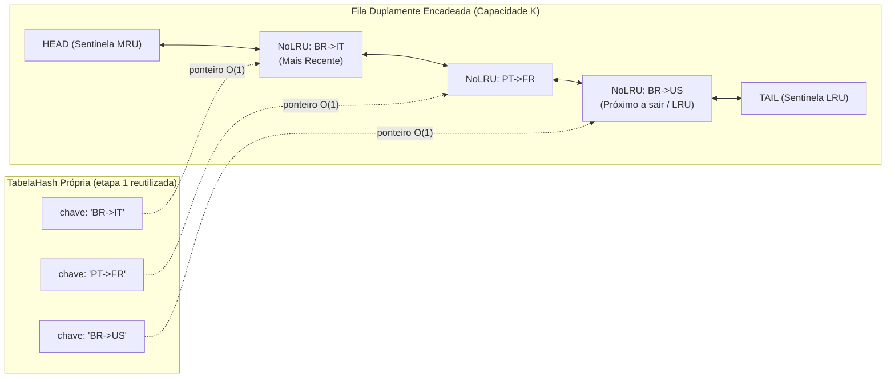
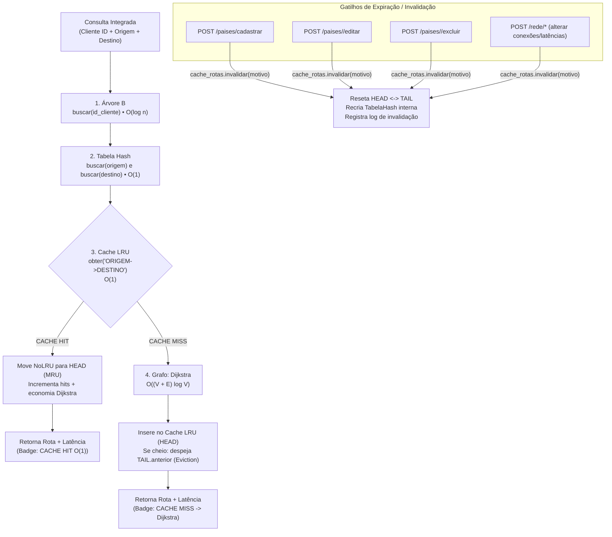

# ⚡ GlobalSIM — Especificação do Diferencial: Sistema de Cache LRU Customizado

<p align="left">
  
  
  
  
</p>

> **Instituição:** Universidade do Estado da Bahia (UNEB) — Campus I  
> **Colegiado:** Bacharelado em Sistemas de Informação  
> **Disciplina:** Estruturas de Dados II  
> **Docente:** Profa. Maria Inés Restovic  
> **Equipe:** Arthur Felipe, Lucas Vinicius, Raphael Lopes  

---

## 1. Motivação e Problema Resolvido

Na integração final da **Etapa 3**, a consulta de conectividade completa do GlobalSIM precisa calcular a rota de menor latência entre um país de origem e um país de destino usando o **algoritmo de Dijkstra** sobre o grafo ponderado da rede internacional:

- **Custo do Dijkstra:** $O((V + E) \log V)$ por consulta (com heap de prioridade) ou $O(V^2)$ em implementação densa.
- **Cenário real de telecomunicações:** rotas populares (como `BR → IT`, `BR → US`, `PT → FR`) são consultadas repetidamente por centenas de clientes cadastrados na Árvore B. Recalcular o caminho mínimo do zero a cada requisição desperdiça processamento e aumenta o tempo de resposta à medida que a malha internacional cresce.

### Solução Proposta
Implementar um **Sistema de Cache LRU (*Least Recently Used*) Customizado** em `estruturas/cache_lru.py`, posicionado como uma camada de aceleração em memória antes do algoritmo de Dijkstra:

1. **Cache Hit ($O(1)$):** se a rota `(origem, destino)` já foi calculada recentemente e está no cache, o resultado (caminho mínimo + latência total) é devolvido imediatamente em tempo constante $O(1)$ sem percorrer o grafo, e a entrada é promovida para o topo de uso recente (**MRU**).
2. **Cache Miss ($O((V + E) \log V) + O(1)$):** se a rota não estiver no cache, o Dijkstra é executado normalmente no grafo e o resultado é armazenado no topo (**MRU**). Caso o cache esteja na capacidade máxima $K$, a rota menos recentemente usada (**LRU**, na cauda da fila) é removida em $O(1)$ (*eviction*).
3. **Invalidação por Consistência:** sempre que a topologia ou a base de países mudar (inserção, edição ou remoção de país na **Etapa 1**, ou modificação de arestas/latências na **Etapa 3**), o cache é **invalidado automaticamente**, garantindo que o sistema nunca devolva uma rota obsoleta ou que passe por um país removido.

---

## 2. Por que Construir Manualmente (Conformidade com as Regras de ED2)

> [!IMPORTANT]
> **Regra da Disciplina:** Assim como na Tabela Hash (Etapa 1) e na Árvore B (Etapa 2), é **proibido** substituir a estrutura por bibliotecas prontas de cache do Python (`functools.lru_cache`, `collections.OrderedDict` ou `dict` puro como motor de indexação).

Para atingir **$O(1)$ simultâneo** em busca, atualização de recência e despejo (*eviction*), o algoritmo clássico de Cache LRU exige o casamento de **duas estruturas de dados complementares**, ambas implementadas manualmente no projeto:

| Estrutura Interna | Papel no Cache LRU | Complexidade | Origem no Projeto |
| :--- | :--- | :---: | :--- |
| **Fila/Lista Duplamente Encadeada (`NoLRU`)** | Mantém a ordem exata de recência de uso entre dois nós sentinelas: `HEAD` (MRU) $\leftrightarrow$ `TAIL` (LRU). Permite mover qualquer nó para o início ou remover o último apenas religando ponteiros `anterior` e `proximo`. | **$O(1)$** (pior caso) | Nova estrutura em `estruturas/cache_lru.py` |
| **Tabela Hash Própria (`TabelaHash`)** | Mapeia a chave composta da rota (ex.: `"BR->IT"`) diretamente para a **referência em memória do objeto `NoLRU`** na lista duplamente encadeada, evitando buscas lineares $O(K)$ na lista. | **$O(1)$** (caso médio) | **Reúso direto** de [`estruturas/tabela_hash.py`](../estruturas/tabela_hash.py) (Etapa 1) |

> [!TIP]
> **Destaque Acadêmico:** Reutilizar a `TabelaHash` construída pela equipe na Etapa 1 dentro do `CacheLRU` demonstra domínio real de composição de estruturas de dados — sem depender de `dict` do Python nem para o índice interno do cache!

---

## 3. Arquitetura e Fluxo de Operações

### 3.1. Estrutura Interna em Memória (Hash + Fila Duplamente Encadeada)



### 3.2. Fluxo na Consulta Final Integrada (Etapa 3) e Gatilhos de Invalidação



---

## 4. Análise de Complexidade

| Operação | Sem Cache (Somente Dijkstra) | Com Cache LRU (Hit) | Com Cache LRU (Miss) | Observação |
| :--- | :---: | :---: | :---: | :--- |
| Consultar rota `(u, v)` | $O((V + E) \log V)$ | **$O(1)$ médio** | $O((V + E) \log V) + O(1)$ | Hit não toca o grafo |
| Promover rota para MRU | — | **$O(1)$ estrito** | **$O(1)$ estrito** | 4 ajustes de ponteiros |
| Despejar rota LRU (*eviction*) | — | — | **$O(1)$ médio** | Remove `TAIL.anterior` + `TabelaHash.remover` |
| Invalidar cache após mutação | — | $O(M)$ (ou $O(1)$ recriando buckets) | — | $M$ = tamanho fixo da hash interna (ex.: 17 ou 31) |
| Memória adicional | $O(1)$ | $O(K)$ | $O(K)$ | Limitada pela capacidade máxima $K$ |

---

## 5. Especificação Técnica (`estruturas/cache_lru.py`)

### 5.1. Formato da Chave e do Valor Armazenado
- **Chave composta normalizada:** `f"{origem.strip().upper()}->{destino.strip().upper()}"` (ex.: `"BR->IT"`).
  - Manter a chave direcionada (`BR->IT` distinta de `IT->BR`) preserva a ordem exata da lista de vértices da rota (`["BR", "PT", "FR", "IT"]`) e já prepara o sistema para eventuais enlaces com latências assimétricas.
- **Valor armazenado (`dict`):**
  ```python
  {
      "origem": "BR",
      "destino": "IT",
      "caminho": ["BR", "PT", "FR", "IT"],
      "latencia_ms": 185,
      "saltos": 3,
      "acessivel": True,
      "iteracoes_dijkstra_economizadas": 12,
  }
  ```

### 5.2. Classe `NoLRU` (Nó da Fila Duplamente Encadeada)
Atributos mínimos:
- `chave: str | None` — identificador da rota (ex.: `"BR->IT"`; `None` nos nós sentinelas `head` e `tail`).
- `valor: dict | None` — payload da rota calculada pelo Dijkstra.
- `anterior: NoLRU | None` — ponteiro para o nó mais recente à esquerda.
- `proximo: NoLRU | None` — ponteiro para o nó menos recente à direita.
- `hits_no: int` — contador de quantas vezes essa rota específica foi reaproveitada (útil na instrumentação visual).

### 5.3. Classe `CacheLRU`
- **Construtor:** `__init__(self, capacidade: int = 8, capacidade_hash: int = 17)`
  - Valida `capacidade >= 1` (senão lança `ValueError`).
  - Inicializa sentinelas `self.head = NoLRU(None, None)` e `self.tail = NoLRU(None, None)` ligados entre si (`head.proximo = tail`, `tail.anterior = head`).
  - Instancia `self._indice = TabelaHash(capacidade_inicial=capacidade_hash)`.
  - Inicializa contadores de instrumentação: `tamanho`, `total_hits`, `total_misses`, `total_evictions`, `total_invalidacoes`, `iteracoes_economizadas`, `historico_eventos` (`deque(maxlen=20)`).
- **Métodos auxiliares de ponteiros ($O(1)$ estrito):**
  - `_adicionar_frente(self, no: NoLRU)`: insere `no` logo após `self.head` (posição MRU).
  - `_remover_no(self, no: NoLRU)`: desconecta `no` ligando `no.anterior.proximo = no.proximo` e `no.proximo.anterior = no.anterior`.
  - `_mover_para_frente(self, no: NoLRU)`: `_remover_no(no)` seguido de `_adicionar_frente(no)`.
  - `_remover_lru(self) -> NoLRU | None`: remove e retorna `self.tail.anterior` (se não for `self.head`).
- **API pública:**
  - `gerar_chave(origem: str, destino: str) -> str` *(staticmethod)*: padroniza `"ORIGEM->DESTINO"`.
  - `obter(self, chave: str) -> dict | None`:
    - Busca `no = self._indice.buscar(chave)`.
    - Se `None`: incrementa `total_misses`, registra evento `"MISS"` e retorna `None`.
    - Se encontrado: chama `_mover_para_frente(no)`, incrementa `total_hits`, `no.hits_no` e `iteracoes_economizadas`, registra evento `"HIT"` e retorna cópia/dados de `no.valor`.
  - `inserir(self, chave: str, valor: dict) -> dict | None`:
    - Se `chave` já existe no `_indice`: atualiza `no.valor = valor` e chama `_mover_para_frente(no)`.
    - Se não existe:
      - Se `self.tamanho >= self.capacidade`: chama `despejado = self._remover_lru()`, remove `despejado.chave` do `self._indice`, decrementa `self.tamanho`, incrementa `total_evictions` e registra evento `"EVICT"`.
      - Cria novo `NoLRU(chave, valor)`, chama `_adicionar_frente(novo)`, insere `self._indice.inserir(chave, novo)` e incrementa `self.tamanho`.
      - Retorna informações do nó despejado (se houve *eviction*) para feedback didático na interface.
  - `invalidar(self, motivo: str = "alteracao_rede") -> int`:
    - Armazena `removidos = self.tamanho`.
    - Reconecta `self.head.proximo = self.tail` e `self.tail.anterior = self.head`.
    - Reinicia `self._indice = TabelaHash(capacidade_inicial=self._capacidade_hash)` e `self.tamanho = 0`.
    - Incrementa `total_invalidacoes`, grava `ultima_invalidacao` (motivo + quantidade descartada) e registra evento `"INVALIDATE"`.
    - Retorna `removidos`.
  - `alterar_capacidade(self, nova_capacidade: int)`:
    - Permite ajustar $K$ ao vivo na interface de instrumentação (removendo nós LRU excedentes caso a nova capacidade seja menor que o tamanho atual).
  - `listar_ordem_uso(self) -> list[dict]`:
    - Percorre de `head.proximo` até `tail` devolvendo as entradas da mais recente (**MRU**, posição `1`) até a menos recente (**LRU**, posição `tamanho`).
  - `obter_metricas(self) -> dict`:
    - Retorna `capacidade`, `tamanho`, `ocupacao_pct`, `total_hits`, `total_misses`, `hit_rate_pct`, `total_evictions`, `total_invalidacoes`, `iteracoes_economizadas`, `ultima_invalidacao`, `ordem_uso`, `metricas_hash_interna` (`self._indice.obter_metricas()`) e `historico_eventos`.
  - `validar(self) -> tuple[bool, str]`:
    - Verifica todas as invariantes estruturais:
      1. `head.anterior is None` e `tail.proximo is None`.
      2. Consistência bidirecional de todos os ponteiros (`atual.proximo.anterior is atual`).
      3. Contagem de nós percorridos de `head` até `tail` é igual a `self.tamanho` e igual a `self._indice.tamanho`.
      4. `self.tamanho <= self.capacidade`.
      5. Todo nó na fila é recuperável em `self._indice.buscar(no.chave)` apontando para a mesma instância de objeto (`is no`).

---

## 6. Política de Expiração e Invalidação de Dados

### Por que invalidação total em alterações de topologia?
Em grafos ponderados, **não basta** invalidar apenas rotas que já contêm o país modificado:
- **Remoção de país ou aresta:** pode desconectar ou encarecer qualquer caminho intermediário que passava por aquele vértice.
- **Inserção de novo país ou redução de latência:** pode criar um atalho mais rápido para rotas já cacheadas que antes não passavam por aquele nó (propriedade global de caminhos mínimos).

Por isso, a estratégia correta e garantidamente consistente é a **invalidação total imediata** (`cache_rotas.invalidar(motivo)`) em todo ponto de mutação da rede:

| Origem | Rota Flask | Evento | Ação no Cache LRU |
| :--- | :--- | :--- | :--- |
| **Etapa 1** | `POST /paises/cadastrar` | Novo país adicionado ou substituído | `cache_rotas.invalidar(f"Cadastro/atualização do país {codigo}")` |
| **Etapa 1** | `POST /paises/<codigo>/editar` | Dados de país alterados | `cache_rotas.invalidar(f"Edição do país {codigo}")` |
| **Etapa 1** | `POST /paises/<codigo>/excluir` | País removido da base | `cache_rotas.invalidar(f"Remoção do país {codigo}")` |
| **Etapa 3** | `POST /rede/conexao/adicionar` | Nova aresta/latência no grafo | `cache_rotas.invalidar(f"Nova conexão {origem} <-> {destino}")` |
| **Etapa 3** | `POST /rede/conexao/editar` | Latência de enlace alterada | `cache_rotas.invalidar(f"Latência alterada em {origem} <-> {destino}")` |
| **Etapa 3** | `POST /rede/conexao/remover` | Enlace removido da rede | `cache_rotas.invalidar(f"Conexão removida {origem} <-> {destino}")` |
| **Painel UI** | `POST /cache-lru/limpar` | Limpeza manual para demonstração | `cache_rotas.invalidar("Limpeza manual pelo painel")` |

> [!NOTE]
> Alterações apenas em **clientes** (`/clientes/*`, na Árvore B) **não alteram** a topologia de países nem a latência das rotas, portanto **não** invalidam o cache de rotas! Isso também é um excelente ponto conceitual para destacar na apresentação.

---

## 7. Instrumentação Visual (`/cache-lru`) e Experiência na Interface

Para tornar o funcionamento do Cache LRU completamente observável durante a apresentação (conforme os critérios de avaliação do trabalho), o sistema contará com:

1. **Badge de Origem do Resultado na Consulta Final (`/consulta`):**
   - Exibe claramente se a rota veio do **Cache LRU (`CACHE HIT · O(1)`)** ou foi calculada agora via **Dijkstra (`CACHE MISS · O((V+E) log V)`)**, com comparativo de operações economizadas.
2. **Painel Dedicado de Instrumentação (`/cache-lru`, no dropdown *Instrumentação*):**
   - **Cards de Telemetria:** Capacidade ($K$), Ocupação ($n/K$), Hits, Misses, Taxa de Acerto (*Hit Rate %*), *Evictions* e Invalidações.
   - **Visualizador da Fila Duplamente Encadeada:** renderização horizontal em painel escuro (mesmo padrão visual de `/instrumentacao` e `/arvore-b`) mostrando `HEAD (MRU) ⇄ [BR→IT] ⇄ [BR→US] ⇄ ... ⇄ TAIL (LRU)`, destacando a quantidade de acessos de cada nó e quem será o próximo despejado em caso de *eviction*.
   - **Espelho da Tabela Hash Interna:** exibição resumida da `TabelaHash` usada internamente pelo cache (capacidade, ocupação e colisões).
   - **Controles Didáticos (POST + PRG):**
     - Formulário para ajustar a capacidade $K$ do cache (ex.: reduzir para `K=3` durante a banca para forçar *eviction* em poucos cliques).
     - Botão de limpeza/invalidação manual.
   - **Log de Eventos em Tempo Real:** últimas operações (`HIT`, `MISS`, `EVICT`, `INVALIDATE`) com o motivo exato de cada invalidação disparada pela Etapa 1 ou Etapa 3.
   - **Selo de Integridade:** resultado em tempo real de `cache_rotas.validar()`.

---

## 8. Checklist de Implementação e Testes

### Módulo da Estrutura (`estruturas/cache_lru.py`)
- [ ] Implementar `NoLRU` com ponteiros `anterior` e `proximo`.
- [ ] Implementar `CacheLRU` com sentinelas `head`/`tail` e índice baseado na `TabelaHash` de `estruturas/tabela_hash.py`.
- [ ] Implementar `obter`, `inserir`, `invalidar`, `alterar_capacidade`, `listar_ordem_uso`, `obter_metricas` e `validar`.

### Integração no Controlador (`app.py`) e Templates
- [ ] Instanciar `cache_rotas = CacheLRU(capacidade=8)` no carregamento da aplicação.
- [ ] Integrar consulta com cache antes da chamada do Dijkstra na rota `/consulta` (Etapa 3).
- [ ] Adicionar gatilhos `cache_rotas.invalidar(...)` em `/paises/cadastrar`, `/paises/<codigo>/editar`, `/paises/<codigo>/excluir` e nas rotas de mutação do grafo `/rede/*`.
- [ ] Criar rota `/cache-lru` (+ rotas POST `/cache-lru/limpar` e `/cache-lru/configurar`) e template `templates/cache_lru.html`.
- [ ] Adicionar item **Cache LRU (Rotas)** no menu dropdown *Instrumentação* em `templates/base.html`.

### Bateria de Testes (`tests/test_cache_lru.py` e `tests/test_app.py`)
- [ ] `test_capacidade_invalida()`: garante `ValueError` para `capacidade < 1`.
- [ ] `test_miss_e_hit_promove_para_mru()`: verifica que `obter()` em um item do meio/cauda o move para `head.proximo`.
- [ ] `test_eviction_remove_menos_recente()`: com `capacidade=3`, insere A, B, C, acessa A (torna B o LRU), insere D e confirma que B foi despejado enquanto A, C e D permanecem válidos.
- [ ] `test_atualizacao_chave_existente_sem_duplicar()`: reinserir chave existente atualiza o valor, promove a MRU e mantém `tamanho` constante.
- [ ] `test_invalidacao_limpa_fila_e_hash()`: verifica reset completo de `head <-> tail`, `_indice`, contagem de invalidações e motivo registrado.
- [ ] `test_alterar_capacidade_menor_despeja_lru()`: reduzir `capacidade` de 5 para 2 mantém apenas os 2 itens mais recentes.
- [ ] `test_invariantes_validar_em_carga()`: valida ponteiros bidirecionais e sincronia fila × `TabelaHash` após centenas de operações aleatórias.
- [ ] `test_integracao_invalidacao_ao_alterar_pais()`: teste Flask comprovando que cadastrar/editar/excluir país na Etapa 1 invalida automaticamente o `cache_rotas` (enquanto editar um cliente na Etapa 2 preserva o cache).

---

## 9. Roteiro Sugerido para a Apresentação Final (01/12/2026)

1. **Mostrar a consulta integrada (Cache Miss):** buscar cliente `58372` com rota `BR → IT` → sistema executa **Árvore B → Tabela Hash → Cache MISS → Dijkstra** (`BR → PT → FR → IT`, 185 ms) e salva no cache.
2. **Repetir a mesma rota para outro cliente (Cache Hit em $O(1)$):** buscar outro cliente com rota `BR → IT` → sistema exibe badge **`CACHE HIT · O(1)`**, provando que o Dijkstra não foi reexecutado.
3. **Demonstrar a política LRU (*Eviction*) ao vivo:** em `/cache-lru`, configurar capacidade `K = 3`, consultar 3 rotas diferentes, reacessar a 1ª (vê-la saltar para `HEAD / MRU`) e consultar uma 4ª rota — provando que a menos recentemente usada em `TAIL` foi descartada em $O(1)$.
4. **Demonstrar a invalidação por consistência:** ir em `/paises` (Etapa 1), cadastrar ou editar um país e retornar a `/cache-lru` — exibindo o cache automaticamente invalidado com o registro exato do motivo no log de eventos.
