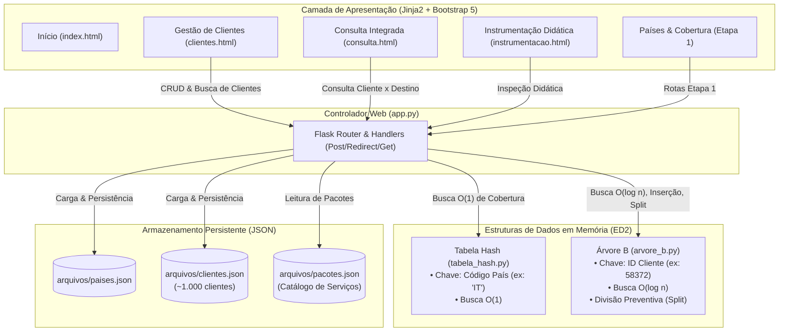

# 🌲 GlobalSIM — Roadmap & Backlog de Implementação (Etapa 2)

<p align="left">
  
  
  
  
  
</p>

> **Instituição:** Universidade do Estado da Bahia (UNEB) — Campus I  
> **Colegiado:** Bacharelado em Sistemas de Informação  
> **Disciplina:** Estruturas de Dados II  
> **Docente:** Profa. Maria Inés Restovic  
> **Equipe:** Arthur Felipe, Lucas Vinicius, Raphael Lopes  

---

## 📊 Dashboard de Progresso

| Módulo / Camada | Componente Principal | Status | Conclusão |
| :--- | :--- | :---: | :---: |
| **Estrutura de Dados** | [`estruturas/arvore_b.py`](estruturas/arvore_b.py) | ⏳ A Fazer | **0%** |
| **Massa de Dados & Catálogo** | [`scripts/gerar_clientes.py`](scripts/gerar_clientes.py) + [`arquivos/clientes.json`](arquivos/clientes.json) + [`arquivos/pacotes.json`](arquivos/pacotes.json) | ⏳ A Fazer | **0%** |
| **Controlador & Persistência** | [`app.py`](app.py) (CRUD de Clientes & Carga JSON) | ⏳ A Fazer | **0%** |
| **Integração B-Tree × Hash** | [`app.py`](app.py) (Consulta Integrada Cliente × País) | ⏳ A Fazer | **0%** |
| **Interface do Usuário** | [`templates/clientes.html`](templates/clientes.html) e [`templates/consulta.html`](templates/consulta.html) | ⏳ A Fazer | **0%** |
| **Instrumentação Didática** | Atualização de [`templates/instrumentacao.html`](templates/instrumentacao.html) com métricas de B-Tree | ⏳ A Fazer | **0%** |
| **Diferencial da Equipe** | 1ª Implementação funcional do Diferencial (Recomendação / Grau $t$) | ⏳ A Fazer | **0%** |
| **Testes Automatizados** | [`tests/test_arvore_b.py`](tests/test_arvore_b.py) | ⏳ A Fazer | **0%** |

---

## 🏗️ Arquitetura Integrada da Etapa 2

A Etapa 2 amplia o sistema adicionando o gerenciamento de centenas/milhares de clientes e eSIMs indexados via **Árvore B**, preservando e integrando integralmente a **Tabela Hash** da Etapa 1.



> [!IMPORTANT]
> **Regra Obrigatória da Disciplina:** É estritamente proibido substituir a Árvore B por `dict`, `list`, SQLite ou bibliotecas prontas como mecanismo principal de indexação e busca de clientes. A Árvore B deve ser implementada artesanalmente com definição de grau mínimo $t$, balanceamento automático com divisão preventiva de nós cheios (*split child*), busca em tempo $O(\log n)$, percurso em ordem e instrumentação didática.

---

## 📋 Checklist Detalhado por Módulo

### 1. `estruturas/arvore_b.py` (Núcleo da Estrutura de Dados)
- [ ] **Classe `NoArvoreB` (Nó da Árvore B)**
  - [ ] Atributo `chaves: list[int]`: lista ordenada de IDs dos clientes indexados no nó.
  - [ ] Atributo `valores: list[dict]`: lista correspondente contendo os dados de cada cliente (nome, email, eSIM, pacote, status).
  - [ ] Atributo `filhos: list[NoArvoreB]`: lista de referências para os nós filhos.
  - [ ] Atributo `folha: bool`: indicador se o nó é uma folha (sem filhos).
- [ ] **Classe `ArvoreB` (Estrutura Principal)**
  - [ ] Construtor `__init__(self, t: int = 3)`: inicializa a raiz como folha vazia e armazena o grau mínimo $t$ (onde cada nó não-raiz comporta entre $t-1$ e $2t-1$ chaves).
  - [ ] **`buscar(self, chave: int) -> dict | None`**:
    - [ ] Algoritmo de busca recursivo/iterativo que percorre os nós a partir da raiz.
    - [ ] Comparação ordenada das chaves no nó localizando o intervalo correto do filho correspondente.
    - [ ] Complexidade temporal $O(\log n)$.
    - [ ] Contador de comparações e nós visitados para instrumentação didática.
  - [ ] **`inserir(self, chave: int, valor: dict)`**:
    - [ ] Inserção com particionamento preventivo: se a raiz estiver cheia ($2t-1$ chaves), aloca uma nova raiz e divide a antiga.
    - [ ] Chamada para o método auxiliar `_inserir_nao_cheio(no, chave, valor)`.
    - [ ] Atualização do contador de divisões (*splits*) e total de chaves indexadas.
    - [ ] Impedimento ou tratamento de chaves duplicadas (mantendo consistência de unicidade de ID).
  - [ ] **`_dividir_filho(self, no_pai: NoArvoreB, indice_filho: int)`**:
    - [ ] Operação clássica de *split child*: divisão do nó filho cheio em dois nós com $t-1$ chaves cada.
    - [ ] Promoção da chave mediana para o nó pai na posição `indice_filho`.
    - [ ] Redistribuição balanceada das referências de filhos caso não seja folha.
    - [ ] Incremento do total acumulado de divisões de nós.
  - [ ] **`_inserir_nao_cheio(self, no: NoArvoreB, chave: int, valor: dict)`**:
    - [ ] Caso folha: inserção direta da chave e valor na posição ordenada correta (deslocamento ou `bisect`).
    - [ ] Caso nó interno: localização do filho adequado; se o filho estiver cheio, divide-o preventivamente antes de descer na recursão.
  - [ ] **`listar_em_ordem(self) -> list[dict]`**:
    - [ ] Percurso em-ordem (*in-order traversal*) da Árvore B para retornar todos os clientes ordenados crescentemente por ID.
    - [ ] Garantia de geração da lista completa para renderização na tabela Web e persistência no arquivo JSON.
  - [ ] **`atualizar(self, chave: int, novos_dados: dict) -> bool`**:
    - [ ] Localização do cliente por ID na Árvore B e atualização em memória de seus atributos (nome, email, pacote, status).
    - [ ] Retorno de confirmação booleana para feedback na interface.
  - [ ] **`obter_altura(self) -> int`**:
    - [ ] Cálculo da altura atual da árvore navegando pelos ramos até a primeira folha.
  - [ ] **`obter_metricas(self) -> dict`**:
    - [ ] Coleta de estatísticas: Grau mínimo ($t$), Altura ($h$), Total de Chaves ($N$), Total de Nós, Total de Divisões (*splits*) e métricas da última busca.
  - [ ] **`para_dicionario(self) -> dict`**:
    - [ ] Serialização da topologia da árvore em estrutura hierárquica (nós, chaves e filhos) para renderização visual e didática no painel de instrumentação.

---

### 2. Geração da Massa de Dados & Catálogo de Pacotes (`scripts/` e `arquivos/`)
- [ ] **`arquivos/pacotes.json` (Catálogo Oficial de Serviços)**
  - [ ] Cadastrar os pacotes formais definidos no enunciado:
    - `101`: "Europa Basic" (5 GB, 15 dias)
    - `102`: "Europa Plus" (10 GB, 30 dias)
    - `201`: "América Basic" (5 GB, 15 dias)
    - `202`: "América Plus" (15 GB, 30 dias)
    - `301`: "Global" (20 GB, 30 dias)
- [ ] **`scripts/gerar_clientes.py` (Gerador de Massa de ~1.000 Clientes)**
  - [ ] Script Python automatizado para gerar 1.000 clientes com dados realistas e reprodutíveis:
    - `id`: número inteiro único de 5 dígitos (ex: `10000` a `99999`).
    - `nome`: nomes e sobrenomes brasileiros/internacionais diversificados.
    - `email`: e-mail correspondente ao nome do cliente.
    - `esim`: identificador padronizado no formato `ESIM-XXXXX`.
    - `pacote`: distribuição proporcional entre os 5 códigos de pacote válidos.
    - `status`: status `"ativo"` (predominante) ou `"inativo"`.
  - [ ] Escrita segura no arquivo `arquivos/clientes.json`.
  - [ ] Suporte a execução via terminal: `python scripts/gerar_clientes.py`.

---

### 3. `app.py` (Controlador Flask & Persistência de Clientes)
- [ ] **Inicialização e Carga de Dados da Etapa 2**
  - [ ] Importar e instanciar `ArvoreB(t=3)` como `arvore_clientes`.
  - [ ] `carregar_clientes()`: leitura de `arquivos/clientes.json` e inserção sistemática de cada registro na `arvore_clientes` na subida da aplicação.
  - [ ] `persistir_clientes()`: extração ordenada de todos os registros via `arvore_clientes.listar_em_ordem()` e escrita formatada em `arquivos/clientes.json`.
  - [ ] `carregar_pacotes()`: leitura de `arquivos/pacotes.json` para mapeamento e listagens nos formulários.
- [ ] **Rota `/clientes` (`methods=["GET"]`)**
  - [ ] Obtenção da lista completa de clientes via percurso em-ordem da Árvore B.
  - [ ] Implementação de paginação eficiente no Flask (ex: 20 a 50 clientes por página) para exibição fluida dos 1.000 registros sem sobrecarregar a renderização do navegador.
  - [ ] Filtro opcional por status ou pacote.
- [ ] **Rota `/clientes/cadastrar` (`methods=["POST"]`)**
  - [ ] Captura de dados: `nome`, `email`, `pacote` e `status`.
  - [ ] Geração automática de ID único (ou fornecido pelo usuário) e código de eSIM no padrão `ESIM-XXXXX`.
  - [ ] Inserção na `arvore_clientes` via `arvore_clientes.inserir(novo_id, dados)`.
  - [ ] Sincronização imediata no arquivo `arquivos/clientes.json`.
  - [ ] Mensagem de sucesso via `flash()` e redirecionamento (*Post/Redirect/Get*).
- [ ] **Rota `/clientes/<int:id_cliente>/editar` (`methods=["POST"]`)**
  - [ ] Captura dos dados atualizados (`nome`, `email`, `pacote`, `status`).
  - [ ] Atualização na estrutura via `arvore_clientes.atualizar(id_cliente, dados_atualizados)`.
  - [ ] Persistência em disco via `persistir_clientes()`.
  - [ ] Feedback visual ao usuário via `flash()`.
- [ ] **Rota `/clientes/buscar` (`methods=["GET", "POST"]`)**
  - [ ] Formulário de busca direta por ID do cliente.
  - [ ] Execução da busca logarítmica na Árvore B: `arvore_clientes.buscar(id_cliente)`.
  - [ ] Exibição detalhada do card do cliente encontrado com badge de status, pacote e estatística de comparações realizadas.

---

### 4. Integração Árvore B × Tabela Hash (Requisito Central da Etapa 2)
- [ ] **Rota `/consulta` (`methods=["GET", "POST"]`)**
  - [ ] Implementação da funcionalidade integrada exigida no PDF (pág. 5):
    - **Entrada do Usuário:** ID do Cliente (ex: `58372`) e Código do País de Destino (ex: `IT`).
    - **Passo 1 (Árvore B):** Busca o cliente na `arvore_clientes.buscar(id_cliente)` $\rightarrow$ obtém Nome, eSIM e Código do Pacote.
    - **Passo 2 (Tabela Hash):** Busca o país de destino na `tabela_paises.buscar(codigo_pais)` $\rightarrow$ obtém Nome do País, Região, Operadora e Tecnologia (5G/4G).
    - **Passo 3 (Regra de Negócio de Telecom):** Cruza a região do país de destino com o pacote do cliente:
      - Pacote Europa (101, 102) $\rightarrow$ Válido apenas para países da região "Europa".
      - Pacote América (201, 202) $\rightarrow$ Válido apenas para países da região "Américas".
      - Pacote Global (301) $\rightarrow$ Válido para qualquer país atendido pela GlobalSIM.
    - **Passo 4 (Apresentação Didática):** Renderização de card explicativo mostrando os dois passos algorítmicos executados pelas duas estruturas de dados distintas.

---

### 5. Camada de Apresentação (`templates/` e `static/`)
- [ ] **`templates/clientes.html` (Gestão Completa de Clientes)**
  - [ ] Tabela com paginação limpa exibindo: ID, Nome, E-mail, eSIM, Pacote associado e Status.
  - [ ] Badges visuais coloridos para status (`Ativo` / `Inativo`) e tipo de pacote.
  - [ ] Barra de busca rápida por ID com destaque do cliente localizado.
  - [ ] Modal intuitivo para cadastro de novo cliente.
  - [ ] Modal para edição dos dados de um cliente existente.
- [ ] **`templates/consulta.html` (Painel de Conectividade Integrada)**
  - [ ] Formulário com seleção/input do ID do cliente e seleção de país de destino.
  - [ ] Card de resultado estilizado ilustrando o fluxo:
    - Box 1: Dados do Cliente recuperados na Árvore B (tempo $O(\log n)$).
    - Box 2: Dados de Cobertura recuperados na Tabela Hash (tempo $O(1)$).
    - Box 3: Diagnóstico de Conectividade (Pacote compatível com o destino ou aviso de incompatibilidade regional).
- [ ] **`templates/base.html` (Atualização de Layout)**
  - [ ] Inclusão dos links de navegação para **"Clientes"** e **"Consulta Integrada"**.
  - [ ] Atualização do badge no header para `Etapa 2 · Árvore B & Clientes`.
- [ ] **`templates/instrumentacao.html` (Expansão do Painel Didático)**
  - [ ] Criação de abas (Tabs do Bootstrap): **"Tabela Hash (Etapa 1)"** e **"Árvore B (Etapa 2)"**.
  - [ ] Seção da Árvore B com cards de telemetria:
    - Grau Mínimo ($t$)
    - Altura da Árvore ($h$)
    - Total de Clientes Indexados ($N$)
    - Total de Nós Alocados
    - Total de Divisões (*Splits*) Executadas
  - [ ] **Visualizador Estrutural:** Representação visual simplificada da hierarquia de nós da Árvore B (Raiz $\rightarrow$ Filhos $\rightarrow$ Folhas).
  - [ ] **Simulador de Desempenho:** Teste comparativo ao vivo entre a Busca Linear $O(N)$ vs Busca na Árvore B $O(\log n)$ demonstrando o número de comparações em tempo real.

---

### 6. Diferencial da Equipe (1ª Implementação Funcional)
- [ ] **Opção A: Simulador de Graus da Árvore B (Sugerido no PDF, pág. 2)**
  - [ ] Módulo didático no painel de instrumentação que permite comparar como diferentes graus mínimos ($t = 2, 3, 5, 10$) afetam a altura final da árvore, o total de nós e a quantidade de divisões (*splits*) geradas para a mesma massa de 1.000 clientes.
- [ ] **Opção B: Módulo Inicial de Recomendação de Pacotes por Itinerário**
  - [ ] Integração preliminar do algoritmo do recomendador: quando o cliente consulta um destino incompatível com seu plano atual, o sistema sugere automaticamente o pacote ideal (ex: upgrade para "Global 301" ou plano regional adequado).

---

### 7. Testes Automatizados (`tests/test_arvore_b.py`)
- [ ] **`test_insercao_basica()`**: inserção de chaves ordenadas e desordenadas em nó não cheio.
- [ ] **`test_divisao_de_nos_split()`**: verificação de cisão de nós ao ultrapassar $2t-1$ chaves e incremento da altura da árvore.
- [ ] **`test_busca_existente_e_inexistente()`**: assertividade para busca de IDs presentes e ausentes.
- [ ] **`test_percurso_em_ordem()`**: garantia de que `listar_em_ordem()` retorna os clientes estritamente ordenados por ID.
- [ ] **`test_carga_mil_clientes()`**: inserção e integridade de 1.000 elementos gerados pelo script.
- [ ] **`test_atualizacao_cliente()`**: verificação de alteração de campos do cliente na estrutura em memória.
- [ ] **`test_integracao_rotas_flask()`**: testes com `client.get("/clientes")`, `client.post("/consulta")` e validação de respostas HTTP 200/302.

---

## 🎯 Critérios de Aceite (Definition of Done)

Para considerar a **Etapa 2** formalmente concluída:

1. **Autonomia Estrutural:** A Árvore B gerencia 100% da indexação e busca dos clientes sem delegar a dicionários ou bibliotecas de indexação externa.
2. **Volume Exigido:** A aplicação sobe com aproximadamente 1.000 clientes carregados de `arquivos/clientes.json` para a Árvore B em memória.
3. **Desempenho Algorítmico:** A busca de clientes por ID ocorre em tempo logarítmico $O(\log n)$, com divisões preventivas (*split child*) implementadas e comprovadas.
4. **Integração Plena (Árvore B × Tabela Hash):** A consulta integrada funciona perfeitamente, consultando o cliente na Árvore B e a cobertura na Tabela Hash.
5. **Preservação da Etapa 1:** Todas as rotas e funcionalidades da Etapa 1 (CRUD de países, mapa Folium, consulta de cobertura e instrumentação de hash) continuam 100% operacionais.
6. **Persistência Confiável:** Qualquer cadastro ou alteração de cliente é sincronizado no arquivo `arquivos/clientes.json` sem corrupção.
7. **Padrão Web Seguro:** Todas as rotas que modificam dados utilizam POST com padrão *Post/Redirect/Get*.
8. **Instrumentação Visual:** A tela `/instrumentacao` exibe a telemetria da Árvore B (altura, nós, splits e comparativo de comparações de busca).
9. **Diferencial Apresentado:** Primeira versão funcional do diferencial devidamente documentada e navegável.

---

## 💻 Como Rodar e Testar a Etapa 2

### 1. Gerar a Massa de Dados Inicial
```bash
python3 scripts/gerar_clientes.py
```

### 2. Rodar a Bateria de Testes
```bash
python3 -m unittest discover tests/
```

### 3. Iniciar a Aplicação Web
```bash
python3 app.py
```
Acesse no navegador: **`http://localhost:5000`** e navegue pelas novas abas **Clientes** e **Consulta Integrada**.

## 🏗️ Arquitetura Integrada da Etapa 2

A Etapa 2 amplia o sistema adicionando o gerenciamento de centenas/milhares de clientes e eSIMs indexados via **Árvore B**, preservando e integrando integralmente a **Tabela Hash** da Etapa 1.


> [!IMPORTANT]
> **Regra Obrigatória da Disciplina:** É estritamente proibido substituir a Árvore B por `dict`, `list`, SQLite ou bibliotecas prontas como mecanismo principal de indexação e busca de clientes. A Árvore B deve ser implementada artesanalmente com definição de grau mínimo $t$, balanceamento automático com divisão preventiva de nós cheios (*split child*), busca em tempo $O(\log n)$, percurso em ordem e instrumentação didática.

---

## 📋 Checklist Detalhado por Módulo

### 1. `estruturas/arvore_b.py` (Núcleo da Estrutura de Dados)
- [ ] **Classe `NoArvoreB` (Nó da Árvore B)**
  - [ ] Atributo `chaves: list[int]`: lista ordenada de IDs dos clientes indexados no nó.
  - [ ] Atributo `valores: list[dict]`: lista correspondente contendo os dados de cada cliente (nome, email, eSIM, pacote, status).
  - [ ] Atributo `filhos: list[NoArvoreB]`: lista de referências para os nós filhos.
  - [ ] Atributo `folha: bool`: indicador se o nó é uma folha (sem filhos).
- [ ] **Classe `ArvoreB` (Estrutura Principal)**
  - [ ] Construtor `__init__(self, t: int = 3)`: inicializa a raiz como folha vazia e armazena o grau mínimo $t$ (onde cada nó não-raiz comporta entre $t-1$ e $2t-1$ chaves).
  - [ ] **`buscar(self, chave: int) -> dict | None`**:
    - [ ] Algoritmo de busca recursivo/iterativo que percorre os nós a partir da raiz.
    - [ ] Comparação ordenada das chaves no nó localizando o intervalo correto do filho correspondente.
    - [ ] Complexidade temporal $O(\log n)$.
    - [ ] Contador de comparações e nós visitados para instrumentação didática.
  - [ ] **`inserir(self, chave: int, valor: dict)`**:
    - [ ] Inserção com particionamento preventivo: se a raiz estiver cheia ($2t-1$ chaves), aloca uma nova raiz e divide a antiga.
    - [ ] Chamada para o método auxiliar `_inserir_nao_cheio(no, chave, valor)`.
    - [ ] Atualização do contador de divisões (*splits*) e total de chaves indexadas.
    - [ ] Impedimento ou tratamento de chaves duplicadas (mantendo consistência de unicidade de ID).
  - [ ] **`_dividir_filho(self, no_pai: NoArvoreB, indice_filho: int)`**:
    - [ ] Operação clássica de *split child*: divisão do nó filho cheio em dois nós com $t-1$ chaves cada.
    - [ ] Promoção da chave mediana para o nó pai na posição `indice_filho`.
    - [ ] Redistribuição balanceada das referências de filhos caso não seja folha.
    - [ ] Incremento do total acumulado de divisões de nós.
  - [ ] **`_inserir_nao_cheio(self, no: NoArvoreB, chave: int, valor: dict)`**:
    - [ ] Caso folha: inserção direta da chave e valor na posição ordenada correta (deslocamento ou `bisect`).
    - [ ] Caso nó interno: localização do filho adequado; se o filho estiver cheio, divide-o preventivamente antes de descer na recursão.
  - [ ] **`listar_em_ordem(self) -> list[dict]`**:
    - [ ] Percurso em-ordem (*in-order traversal*) da Árvore B para retornar todos os clientes ordenados crescentemente por ID.
    - [ ] Garantia de geração da lista completa para renderização na tabela Web e persistência no arquivo JSON.
  - [ ] **`atualizar(self, chave: int, novos_dados: dict) -> bool`**:
    - [ ] Localização do cliente por ID na Árvore B e atualização em memória de seus atributos (nome, email, pacote, status).
    - [ ] Retorno de confirmação booleana para feedback na interface.
  - [ ] **`obter_altura(self) -> int`**:
    - [ ] Cálculo da altura atual da árvore navegando pelos ramos até a primeira folha.
  - [ ] **`obter_metricas(self) -> dict`**:
    - [ ] Coleta de estatísticas: Grau mínimo ($t$), Altura ($h$), Total de Chaves ($N$), Total de Nós, Total de Divisões (*splits*) e métricas da última busca.
  - [ ] **`para_dicionario(self) -> dict`**:
    - [ ] Serialização da topologia da árvore em estrutura hierárquica (nós, chaves e filhos) para renderização visual e didática no painel de instrumentação.

---

### 2. Geração da Massa de Dados & Catálogo de Pacotes (`scripts/` e `arquivos/`)
- [ ] **`arquivos/pacotes.json` (Catálogo Oficial de Serviços)**
  - [ ] Cadastrar os pacotes formais definidos no enunciado:
    - `101`: "Europa Basic" (5 GB, 15 dias)
    - `102`: "Europa Plus" (10 GB, 30 dias)
    - `201`: "América Basic" (5 GB, 15 dias)
    - `202`: "América Plus" (15 GB, 30 dias)
    - `301`: "Global" (20 GB, 30 dias)
- [ ] **`scripts/gerar_clientes.py` (Gerador de Massa de ~1.000 Clientes)**
  - [ ] Script Python automatizado para gerar 1.000 clientes com dados realistas e reprodutíveis:
    - `id`: número inteiro único de 5 dígitos (ex: `10000` a `99999`).
    - `nome`: nomes e sobrenomes brasileiros/internacionais diversificados.
    - `email`: e-mail correspondente ao nome do cliente.
    - `esim`: identificador padronizado no formato `ESIM-XXXXX`.
    - `pacote`: distribuição proporcional entre os 5 códigos de pacote válidos.
    - `status`: status `"ativo"` (predominante) ou `"inativo"`.
  - [ ] Escrita segura no arquivo `arquivos/clientes.json`.
  - [ ] Suporte a execução via terminal: `python scripts/gerar_clientes.py`.

---

### 3. `app.py` (Controlador Flask & Persistência de Clientes)
- [ ] **Inicialização e Carga de Dados da Etapa 2**
  - [ ] Importar e instanciar `ArvoreB(t=3)` como `arvore_clientes`.
  - [ ] `carregar_clientes()`: leitura de `arquivos/clientes.json` e inserção sistemática de cada registro na `arvore_clientes` na subida da aplicação.
  - [ ] `persistir_clientes()`: extração ordenada de todos os registros via `arvore_clientes.listar_em_ordem()` e escrita formatada em `arquivos/clientes.json`.
  - [ ] `carregar_pacotes()`: leitura de `arquivos/pacotes.json` para mapeamento e listagens nos formulários.
- [ ] **Rota `/clientes` (`methods=["GET"]`)**
  - [ ] Obtenção da lista completa de clientes via percurso em-ordem da Árvore B.
  - [ ] Implementação de paginação eficiente no Flask (ex: 20 a 50 clientes por página) para exibição fluida dos 1.000 registros sem sobrecarregar a renderização do navegador.
  - [ ] Filtro opcional por status ou pacote.
- [ ] **Rota `/clientes/cadastrar` (`methods=["POST"]`)**
  - [ ] Captura de dados: `nome`, `email`, `pacote` e `status`.
  - [ ] Geração automática de ID único (ou fornecido pelo usuário) e código de eSIM no padrão `ESIM-XXXXX`.
  - [ ] Inserção na `arvore_clientes` via `arvore_clientes.inserir(novo_id, dados)`.
  - [ ] Sincronização imediata no arquivo `arquivos/clientes.json`.
  - [ ] Mensagem de sucesso via `flash()` e redirecionamento (*Post/Redirect/Get*).
- [ ] **Rota `/clientes/<int:id_cliente>/editar` (`methods=["POST"]`)**
  - [ ] Captura dos dados atualizados (`nome`, `email`, `pacote`, `status`).
  - [ ] Atualização na estrutura via `arvore_clientes.atualizar(id_cliente, dados_atualizados)`.
  - [ ] Persistência em disco via `persistir_clientes()`.
  - [ ] Feedback visual ao usuário via `flash()`.
- [ ] **Rota `/clientes/buscar` (`methods=["GET", "POST"]`)**
  - [ ] Formulário de busca direta por ID do cliente.
  - [ ] Execução da busca logarítmica na Árvore B: `arvore_clientes.buscar(id_cliente)`.
  - [ ] Exibição detalhada do card do cliente encontrado com badge de status, pacote e estatística de comparações realizadas.

---

### 4. Integração Árvore B × Tabela Hash (Requisito Central da Etapa 2)
- [ ] **Rota `/consulta` (`methods=["GET", "POST"]`)**
  - [ ] Implementação da funcionalidade integrada exigida no PDF (pág. 5):
    - **Entrada do Usuário:** ID do Cliente (ex: `58372`) e Código do País de Destino (ex: `IT`).
    - **Passo 1 (Árvore B):** Busca o cliente na `arvore_clientes.buscar(id_cliente)` $\rightarrow$ obtém Nome, eSIM e Código do Pacote.
    - **Passo 2 (Tabela Hash):** Busca o país de destino na `tabela_paises.buscar(codigo_pais)` $\rightarrow$ obtém Nome do País, Região, Operadora e Tecnologia (5G/4G).
    - **Passo 3 (Regra de Negócio de Telecom):** Cruza a região do país de destino com o pacote do cliente:
      - Pacote Europa (101, 102) $\rightarrow$ Válido apenas para países da região "Europa".
      - Pacote América (201, 202) $\rightarrow$ Válido apenas para países da região "Américas".
      - Pacote Global (301) $\rightarrow$ Válido para qualquer país atendido pela GlobalSIM.
    - **Passo 4 (Apresentação Didática):** Renderização de card explicativo mostrando os dois passos algorítmicos executados pelas duas estruturas de dados distintas.

---

### 5. Camada de Apresentação (`templates/` e `static/`)
- [ ] **`templates/clientes.html` (Gestão Completa de Clientes)**
  - [ ] Tabela com paginação limpa exibindo: ID, Nome, E-mail, eSIM, Pacote associado e Status.
  - [ ] Badges visuais coloridos para status (`Ativo` / `Inativo`) e tipo de pacote.
  - [ ] Barra de busca rápida por ID com destaque do cliente localizado.
  - [ ] Modal intuitivo para cadastro de novo cliente.
  - [ ] Modal para edição dos dados de um cliente existente.
- [ ] **`templates/consulta.html` (Painel de Conectividade Integrada)**
  - [ ] Formulário com seleção/input do ID do cliente e seleção de país de destino.
  - [ ] Card de resultado estilizado ilustrando o fluxo:
    - Box 1: Dados do Cliente recuperados na Árvore B (tempo $O(\log n)$).
    - Box 2: Dados de Cobertura recuperados na Tabela Hash (tempo $O(1)$).
    - Box 3: Diagnóstico de Conectividade (Pacote compatível com o destino ou aviso de incompatibilidade regional).
- [ ] **`templates/base.html` (Atualização de Layout)**
  - [ ] Inclusão dos links de navegação para **"Clientes"** e **"Consulta Integrada"**.
  - [ ] Atualização do badge no header para `Etapa 2 · Árvore B & Clientes`.
- [ ] **`templates/instrumentacao.html` (Expansão do Painel Didático)**
  - [ ] Criação de abas (Tabs do Bootstrap): **"Tabela Hash (Etapa 1)"** e **"Árvore B (Etapa 2)"**.
  - [ ] Seção da Árvore B com cards de telemetria:
    - Grau Mínimo ($t$)
    - Altura da Árvore ($h$)
    - Total de Clientes Indexados ($N$)
    - Total de Nós Alocados
    - Total de Divisões (*Splits*) Executadas
  - [ ] **Visualizador Estrutural:** Representação visual simplificada da hierarquia de nós da Árvore B (Raiz $\rightarrow$ Filhos $\rightarrow$ Folhas).
  - [ ] **Simulador de Desempenho:** Teste comparativo ao vivo entre a Busca Linear $O(N)$ vs Busca na Árvore B $O(\log n)$ demonstrando o número de comparações em tempo real.

---

### 6. Diferencial da Equipe (1ª Implementação Funcional)
- [ ] **Opção A: Simulador de Graus da Árvore B (Sugerido no PDF, pág. 2)**
  - [ ] Módulo didático no painel de instrumentação que permite comparar como diferentes graus mínimos ($t = 2, 3, 5, 10$) afetam a altura final da árvore, o total de nós e a quantidade de divisões (*splits*) geradas para a mesma massa de 1.000 clientes.
- [ ] **Opção B: Módulo Inicial de Recomendação de Pacotes por Itinerário**
  - [ ] Integração preliminar do algoritmo do recomendador: quando o cliente consulta um destino incompatível com seu plano atual, o sistema sugere automaticamente o pacote ideal (ex: upgrade para "Global 301" ou plano regional adequado).

---

### 7. Testes Automatizados (`tests/test_arvore_b.py`)
- [ ] **`test_insercao_basica()`**: inserção de chaves ordenadas e desordenadas em nó não cheio.
- [ ] **`test_divisao_de_nos_split()`**: verificação de cisão de nós ao ultrapassar $2t-1$ chaves e incremento da altura da árvore.
- [ ] **`test_busca_existente_e_inexistente()`**: assertividade para busca de IDs presentes e ausentes.
- [ ] **`test_percurso_em_ordem()`**: garantia de que `listar_em_ordem()` retorna os clientes estritamente ordenados por ID.
- [ ] **`test_carga_mil_clientes()`**: inserção e integridade de 1.000 elementos gerados pelo script.
- [ ] **`test_atualizacao_cliente()`**: verificação de alteração de campos do cliente na estrutura em memória.
- [ ] **`test_integracao_rotas_flask()`**: testes com `client.get("/clientes")`, `client.post("/consulta")` e validação de respostas HTTP 200/302.

---

## 🎯 Critérios de Aceite (Definition of Done)

Para considerar a **Etapa 2** formalmente concluída:

1. **Autonomia Estrutural:** A Árvore B gerencia 100% da indexação e busca dos clientes sem delegar a dicionários ou bibliotecas de indexação externa.
2. **Volume Exigido:** A aplicação sobe com aproximadamente 1.000 clientes carregados de `arquivos/clientes.json` para a Árvore B em memória.
3. **Desempenho Algorítmico:** A busca de clientes por ID ocorre em tempo logarítmico $O(\log n)$, com divisões preventivas (*split child*) implementadas e comprovadas.
4. **Integração Plena (Árvore B × Tabela Hash):** A consulta integrada funciona perfeitamente, consultando o cliente na Árvore B e a cobertura na Tabela Hash.
5. **Preservação da Etapa 1:** Todas as rotas e funcionalidades da Etapa 1 (CRUD de países, mapa Folium, consulta de cobertura e instrumentação de hash) continuam 100% operacionais.
6. **Persistência Confiável:** Qualquer cadastro ou alteração de cliente é sincronizado no arquivo `arquivos/clientes.json` sem corrupção.
7. **Padrão Web Seguro:** Todas as rotas que modificam dados utilizam POST com padrão *Post/Redirect/Get*.
8. **Instrumentação Visual:** A tela `/instrumentacao` exibe a telemetria da Árvore B (altura, nós, splits e comparativo de comparações de busca).
9. **Diferencial Apresentado:** Primeira versão funcional do diferencial devidamente documentada e navegável.

---

## 💻 Como Rodar e Testar a Etapa 2

### 1. Gerar a Massa de Dados Inicial
```bash
python3 scripts/gerar_clientes.py
```

### 2. Rodar a Bateria de Testes
```bash
python3 -m unittest discover tests/
```

### 3. Iniciar a Aplicação Web
```bash
python3 app.py
```
Acesse no navegador: **`http://localhost:5000`** e navegue pelas novas abas **Clientes** e **Consulta Integrada**.

