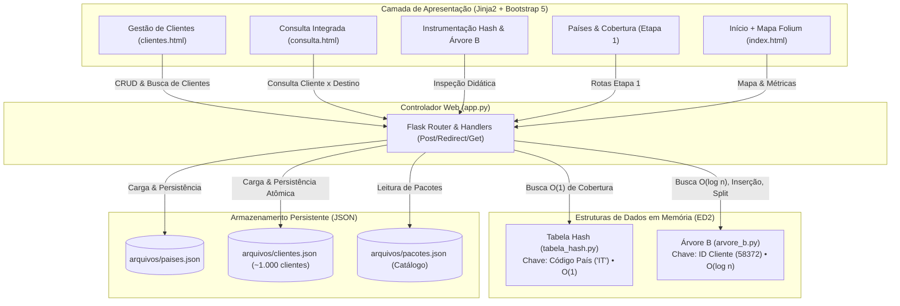

# 🌲 GlobalSIM — Roadmap & Backlog de Implementação (Etapa 2)

<p align="left">
  
  
  
  
  
</p>

> **Instituição:** Universidade do Estado da Bahia (UNEB) — Campus I  
> **Colegiado:** Bacharelado em Sistemas de Informação  
> **Disciplina:** Estruturas de Dados II  
> **Docente:** Profa. Maria Inés Restovic  
> **Equipe:** Arthur Felipe, Lucas Vinicius, Raphael Lopes  

---

## 📊 Dashboard de Progresso

| Módulo / Camada | Componente Principal | Status | Conclusão |
| :--- | :--- | :---: | :---: |
| **Estrutura de Dados** | [`estruturas/arvore_b.py`](../estruturas/arvore_b.py) | ✅ Concluído | **100%** |
| **Massa de Dados & Catálogo** | [`scripts/gerar_clientes.py`](../scripts/gerar_clientes.py) + [`arquivos/clientes.json`](../arquivos/clientes.json) + [`arquivos/pacotes.json`](../arquivos/pacotes.json) | ✅ Concluído | **100%** |
| **Controlador & Persistência** | [`app.py`](../app.py) (CRUD de Clientes, Associação & Carga JSON) | ✅ Concluído | **100%** |
| **Integração B-Tree × Hash** | [`app.py`](../app.py) (Consulta Integrada Cliente × País em `/consulta`) | ✅ Concluído | **100%** |
| **Interface do Usuário** | [`templates/clientes.html`](../templates/clientes.html) e [`templates/consulta.html`](../templates/consulta.html) | ✅ Concluído | **100%** |
| **Instrumentação Didática** | [`templates/arvore_b.html`](../templates/arvore_b.html) + [`templates/instrumentacao.html`](../templates/instrumentacao.html) | ✅ Concluído | **100%** |
| **Diferencial da Equipe** | Especificação do **Cache LRU Customizado** em [`etapas/DIFERENCIAL_CACHE_LRU.md`](DIFERENCIAL_CACHE_LRU.md) (integração na Etapa 3 com Dijkstra) | 📋 Especificado | **Pronto p/ Etapa 3** |
| **Testes Automatizados** | [`tests/test_arvore_b.py`](../tests/test_arvore_b.py) + [`tests/test_app.py`](../tests/test_app.py) + [`tests/test_tabela_hash.py`](../tests/test_tabela_hash.py) | ✅ Concluído | **100%** |

---

## 🏗️ Arquitetura Integrada da Etapa 2

A Etapa 2 amplia o sistema adicionando o gerenciamento de ~1.000 clientes e eSIMs indexados via **Árvore B**, preservando e integrando integralmente a **Tabela Hash** e os mapas interativos Folium/Geopy da Etapa 1.



> [!IMPORTANT]
> **Regra Obrigatória da Disciplina:** A Árvore B gerencia integralmente a indexação, busca e atualização de clientes sem delegar a `dict`, `list`, SQLite ou bibliotecas externas. Implementada com grau mínimo $t=3$, divisão preventiva de nós cheios (*split child*), percurso em ordem, validação de invariantes e instrumentação didática.

---

## 📋 Checklist Detalhado por Módulo

### 1. `estruturas/arvore_b.py` (Núcleo da Estrutura de Dados)
- [x] **Classe `NoB` (Nó da Árvore B):** `id`, `folha`, `chaves`, `valores`, `filhos`.
- [x] **Classe `ArvoreB` (Estrutura Principal):**
  - [x] Construtor `__init__(self, grau_minimo: int = 3)` com validação `t >= 2`.
  - [x] `buscar(self, chave)` com complexidade $O(t \cdot \log_t n)$ e registro de caminho, acessos e comparações.
  - [x] `contem(self, chave)` sem poluir métricas de busca.
  - [x] `inserir(self, chave, valor)` com particionamento preventivo da raiz e rejeição de IDs duplicados.
  - [x] `_dividir_filho(self, pai, indice)` com promoção da chave mediana e histórico de divisões.
  - [x] `_inserir_em_no_nao_cheio(self, no, chave, valor)` em passagem descendente única.
  - [x] `atualizar(self, chave, valor)` preservando a topologia da árvore.
  - [x] `listar_todos()` (percurso em ordem) e `listar_em_ordem_de_insercao()` (persistência determinística).
  - [x] `altura()`, `niveis()`, `obter_metricas()` e `validar()` (verificação de invariantes).

### 2. Geração da Massa de Dados & Catálogo (`scripts/` e `arquivos/`)
- [x] `arquivos/pacotes.json`: pacotes oficiais `101`, `102`, `201`, `202` e `301`.
- [x] `scripts/gerar_clientes.py`: gerador determinístico de ~1.000 clientes (incluindo `58372` / Maria Silva).
- [x] `arquivos/clientes.json`: massa inicial gerada e validada.
- [x] `arquivos/paises.json`: preservadas coordenadas `lat`/`lon`, restaurada Itália (`IT`) e padronizadas operadoras.

### 3. `app.py` (Controlador Flask & Persistência)
- [x] Carga inicial de países (`TabelaHash`), pacotes e ~1.000 clientes (`ArvoreB(grau_minimo=3)`).
- [x] Persistência atômica de clientes em `arquivos/clientes.json`.
- [x] Rotas `/clientes`, `/clientes/cadastrar`, `/clientes/<id>/editar` e `/clientes/<id>/associar` (POST + PRG).
- [x] Rota `/arvore-b` com visualização por níveis, caminho de busca e validação de invariantes.
- [x] Rota `/consulta` integrando Árvore B × Tabela Hash com normalização segura de regiões (`América` / `Américas`).
- [x] Preservação integral de todas as rotas da Etapa 1 (incluindo mapas Folium e validação Geopy).

### 4. Camada de Apresentação (`templates/` e `static/`)
- [x] `templates/clientes.html`, `templates/consulta.html` e `templates/arvore_b.html`.
- [x] `templates/base.html` atualizado com navegação das Etapas 1 e 2 e dropdown de Instrumentação (Hash e Árvore B).
- [x] `templates/index.html` preservando o mapa Folium e exibindo cards e métricas da Tabela Hash e Árvore B.
- [x] `static/css/style.css` atualizado com tokens e componentes da Etapa 2.

### 5. Diferencial da Equipe (Definição Atualizada)
- [x] **Sistema de Cache LRU (*Least Recently Used*) Customizado** especificado em [`etapas/DIFERENCIAL_CACHE_LRU.md`](DIFERENCIAL_CACHE_LRU.md):
  - Otimiza diretamente as consultas de menor latência via Dijkstra na Etapa 3 (retorno em $O(1)$ para rotas frequentes).
  - Construído artesanalmente combinando **Fila Duplamente Encadeada + Tabela Hash própria** (reutilizando `estruturas/tabela_hash.py`), com invalidação automática em mutações de países (Etapa 1) e da rede (Etapa 3).

### 6. Testes Automatizados (`tests/`)
- [x] `tests/test_tabela_hash.py` (Etapa 1 preservada).
- [x] `tests/test_arvore_b.py` (inserção, splits, 1.000 clientes, múltiplos graus, limite teórico de altura e reconstrução).
- [x] `tests/test_app.py` (testes de rotas Flask das Etapas 1 e 2, normalização de região, CRUD de clientes e `/consulta`).

---

## 💻 Como Rodar e Testar a Etapa 2

### 1. Gerar a Massa de Dados Inicial (opcional — já existe em `arquivos/clientes.json`)
```bash
python3 scripts/gerar_clientes.py
```

### 2. Rodar a Bateria Completa de Testes
```bash
# Via Python / venv:
python3 -m unittest discover -s tests -v

# Ou via NixOS:
nix-shell --run "python3 -m unittest discover -s tests -v"
```

### 3. Iniciar a Aplicação Web
```bash
# Via Python / venv:
python3 app.py

# Ou via NixOS:
nix-shell --run "python3 app.py"
```
Acesse no navegador: **`http://localhost:5000`** e navegue pelas abas **Cobertura**, **Países**, **Clientes**, **Consulta** e **Instrumentação (Hash / Árvore B)**.
